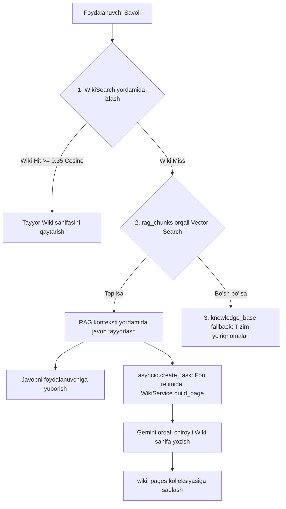

# 📊 Sud Qo'llanma Bot ("SUD IT MENTOR") — To'liq Loyiha Hisoboti (Project Report)

Ushbu hisobot O'zbekiston sud tizimi xodimlari uchun maxsus ishlab chiqilgan **"Sud Qo'llanma Bot"** (SUD IT MENTOR) loyihasining joriy holati, texnik arxitekturasi, modullari hamda yaqinda joriy etilgan **LLM Wiki** tizimi bo'yicha to'liq tahlilni o'z ichiga oladi.

---

## 📌 1. Umumiy Ma'lumot va Missiya

*   **Loyiha nomi:** Sud Qo'llanma Bot ("SUD IT MENTOR")
*   **Missiyasi:** Sud xodimlarining (kotiblar, sudyalar, IT mutaxassislar) kundalik ish faoliyatida duch keladigan raqamli va IT tizimlar (masalan: *E-SUD, E-XAT, E-IMZO, JIB.SUD.UZ, VKS, MY.SUD.UZ*) bo'yicha texnik muammolarini asinxron tarzda hal qilish hamda ularning raqamli savodxonligini oshirish.
*   **Tizimdagi roli:** Yuridik maslahatchi emas, balki **"Raqamli Murabbiy va Texnik Ko'makchi"**. Ushbu bot "Sud Qo'llanma" mobil ilovasining (Flutter) umumiy ekotizim qismi sifatida ishlab chiqilgan.

---

## 🏗 2. Texnologik Stek (Tech Stack)

Botning arxitekturasi zamonaviy, tezkor va bulutli infratuzilmalarga to'liq moslashgan texnologiyalar ustiga qurilgan:

*   **Dasturlash tili:** Python 3.11+
*   **Framework:** `aiogram 3.x` (yuqori yuklamalarga chidamli, asinxron Telegram bot framework)
*   **Ma'lumotlar Bazasi:** `Firebase Firestore` (NoSQL) — real vaqt rejimida ishlovchi va Flutter mobil ilovasi bilan to'liq sinxronlashgan yagona ma'lumotlar bazasi.
*   **Sun'iy Intelekt (AI) & RAG:** `Google Gemini (Generative AI)`
    *   *Matn generatsiyasi uchun:* `gemini-3.1-flash-lite-preview` yoki `gemini-2.5-flash`
    *   *Vektorli qidiruv (Embedding) uchun:* `gemini-embedding-2` (Dimension: 768)
*   **Infratuzilma va Server:** `Google Cloud Run` (Docker-konteyner orqali, webhook rejimida scale-to-zero xususiyati bilan ishlaydi).
*   **Avtomatlashtirilgan vazifalar:** `Cloud Run Jobs` & `Cloud Scheduler` (haftalik fon tozalash va tahlil ishlari uchun).

---

## 🧠 3. LLM Wiki + RAG Gibrid Arxitekturasi

Loyihaning eng muhim va intellektual yangilanishi bu **LLM Wiki** qatlamidir. U an'anaviy RAG tizimini aqlli kesh va avtomatik bilim to'plash zanjiri bilan birlashtiradi.



### 🔍 Kontekst Qidiruv Zanjiri (Search Chain):
1.  **Wiki qatlami:** Foydalanuvchi so'rovi kelganda, tizim birinchi navbatda `wiki_pages` kolleksiyasidan Cosine Vector Search orqali mos tayyor maqolani qidiradi (`COSINE_THRESHOLD = 0.35`). Topilsa, tayyor va chiroyli tartiblangan maqolani qaytaradi. Bu foydalanuvchiga javob berish tezligini oshiradi va Gemini tokenlarini tejaydi.
2.  **RAG Fallback:** Wikida topilmasa, tizim `rag_chunks` kolleksiyasidan embedding orqali RAG Vector Search bajaradi.
3.  **Fon rejimida Wiki qurish:** RAG muvaffaqiyatli ma'lumot topganda, foydalanuvchiga javob qaytarish bilan bir qatorda asinxron ravishda fon rejimida `WikiService.build_page` ishga tushib, ushbu mavzu bo'yicha mukammal wiki sahifa tayyorlab bazaga kesh sifatida saqlaydi. Keyingi safar xuddi shu yoki o'xshash savol berilganda, tizim 1-bosqichdayoq wikidan javob beradi.
4.  **Tizim yo'riqnomalari (Manuals Fallback):** Agar vector qidiruvlari natija bermasa, an'anaviy `knowledge_base` yo'riqnomalari fallback sifatida ishlatiladi.

---

## ⚙️ 4. Asosiy Modullar va Imkoniyatlar (Key Features)

1.  **Identifikatsiya va Sinxronizatsiya (`handlers/onboarding.py`):**
    *   Telegram foydalanuvchilarini telefon raqami orqali verifikatsiya qilish.
    *   Telegram profilini Firestore'dagi Flutter ilova foydalanuvchisi (UID) bilan bog'lash, ballar (XP) va darajalarni (Level) sinxron saqlash.
2.  **AI HelpDesk (RAG):**
    *   Rasmiy sud yo'riqnomalari asosida AI xodimlarning savollariga empatiya bilan, lavozimiga mos uslubda, qadam-baqadam javob beradi.
3.  **Dinamik Quizzes (Testlar):**
    *   Sud IT savodxonligini oshirish uchun tasodifiy testlar yaratiladi va to'g'ri javoblar uchun Firestore-da foydalanuvchi XP ballari oshirib boriladi.
4.  **Statistika menyusi:**
    *   Foydalanuvchining o'z faoliyati, darajasi, yechgan testlari bo'yicha to'liq hisobot.

---

## 🗄 5. Firestore Kolleksiyalari Tuzilishi

*   `wiki_pages` — LLM tomonidan yozilgan strukturalangan kesh sahifalar (slug, title, content, embedding, source_query, hit_count, updated_at).
*   `rag_chunks` — Hujjatlar bo'laklari va ularning embeddinglari.
*   `knowledge_base` — Umumiy tizim yo'riqnomalari va maqolalari.
*   `faqs` — Tayyor savol-javoblar to'plami.
*   `users` — Foydalanuvchilar va ularning profillari (TG ID, roli, XP, Level va h.k.).
*   `wiki_log` — Haftalik linter (Job) hisobotlari va loglari.

---

## 🛠 6. Cloud Run Job & Haftalik Linter Tizimi

Wiki sahifalarning sifati va dolzarbligini nazorat qilish maqsadida Cloud Run scale-to-zero cheklovlaridan xoli bo'lgan **Cloud Run Job** va **Cloud Scheduler** tizimi joriy etilgan:

*   **`scripts/wiki_linter.py`**: Haftada bir marta ishlaydigan mustaqil skript. U barcha yaratilgan wiki sahifalarni tahlil qiladi (Adversarial Review - Creator vs Reviewer yordamida), eskirgan yoki xato yozilgan sahifalarni qayta kompilyatsiya qiladi va hisobotlarni `wiki_log` kolleksiyasiga yozadi.
*   **Haftalik Scheduler**: Har shanba kuni Toshkent vaqti bilan soat `09:00` da avtomatik ravishda Cloud Run Job orqali ushbu linter skriptini ishga tushiradi.

---

## 📂 7. Loyihaning Fayl Tuzilmasi

```text
sudqollanma_bot/
│
├── main.py                     # Bot entry point (Webhook & Polling boshqaruvchi)
├── loader.py                   # Firebase, Gemini va Bot drayverlarini yuklovchi
├── config.py                   # Loyiha sozlamalari va muhit o'zgaruvchilari
├── Dockerfile                  # Cloud Run deploy uchun Docker qo'llanmasi
├── requirements.txt            # Kutubxonalar ro'yxati (aiogram, google-genai, firebase-admin)
│
├── handlers/                   # Telegram controllerlari
│   ├── commands.py             # Buyruqlar boshqaruvi (/start, /profile, /about)
│   ├── helpdesk.py             # AI RAG yordam stoli menyusi
│   ├── onboarding.py           # Ro'yxatdan o'tish va mobil ilova bog'lanishi
│   ├── quizzes.py              # IT testlar va gamifikatsiya mantiqi
│   ├── middleware.py           # Anti-spam (throttling) middleware
│   └── stats.py                # Profil va statistika menyulari
│
├── services/                   # Biznes logikalari
│   ├── ai_service.py           # Gemini AI integratsiyasi va promptlar zanjiri
│   ├── wiki_service.py         # LLM Wiki qatlami (search, build, cache boshqaruvi)
│   └── firestore_service.py    # Firestore DB bilan ishlash
│
└── scripts/                    # Utilita va avtomatlashtirish skriptlari
    ├── wiki_builder.py         # Boshlang'ich seed-skript (KB dan Wiki yaratish)
    ├── wiki_linter.py          # Haftalik tahlilchi va tekshiruvchi (Job)
    ├── pdf_to_md.py            # PDF hujjatlarni MarkDown formatiga o'tkazuvchi
    └── upload_knowledge.py     # MD ma'lumotlarni embedding qilib Firestore RAGga yuklovchi
```

---

## 📈 8. Keyingi Bosqich Rejalari (Roadmap)

1.  **Ticketing System (Arizalar tizimi):** AI javob berolmagan murakkab IT muammolari bo'yicha bot ichida avtomatik ravishda chipta (tiket) yaratiladi va mas'ul IT administratorlarga yo'naltiriladi.
2.  **O'zaro havolalar (Related Wiki Pages):** Wiki sahifalarining ostida bog'liq bo'lgan boshqa wiki sahifalariga havolalar (`[E-IMZO o'rnatish](...)` kabi) chiqariladi.
3.  **Analytics Dashboard:** Firestore'dagi `hit_count` va `wiki_log` ko'rsatkichlari asosida sud tizimining qaysi hududida qaysi IT platformada eng ko'p muammo bo'layotganini ko'rsatuvchi ma'muriy panel.

---
*Hisobot sanasi: 2-Iyun, 2026-yil.*
